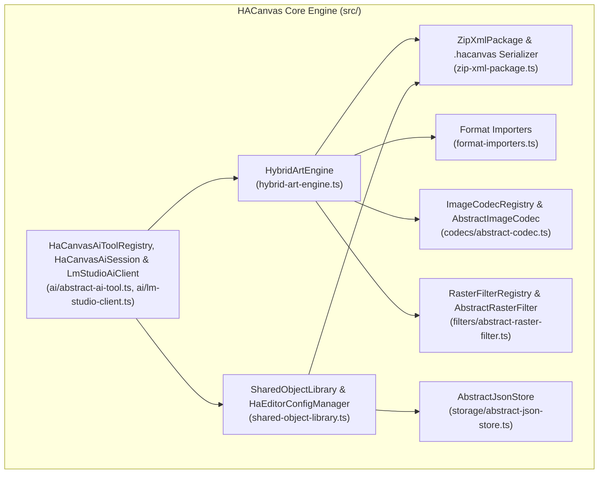

# HACanvas (`.hacanvas`)

**HACanvas** is a TypeScript/Node.js hybrid 2D **Raster (GIMP) + Vector (Inkscape/SVG)** art engine, multi-format codec registry, cross-project Reusable Shared Object Library (`.haso`), and Open Packaging Conventions (`.docx`-style **ZIP + XML**) document package format (`.hacanvas`).

---

## Key Features

- **📦 `.hacanvas` Open Packaging ZIP + XML Document Format**:
  - Self-contained, lossless ZIP archive modeled after ECMA-376 Open Packaging Conventions (`[Content_Types].xml`, `_rels/.rels`, `canvas/document.xml`, `objects/<objectId>.xml`, `media/layer_*.raw`, `media/cel_*.raw`).
  - Stores vector layers, raw RGBA pixel buffers, per-frame animation cels, keyframe interpolation tracks, and reusable Shared Object sub-canvases in a single portable package.
- **🖌️ GIMP-Grade Raster Compositing & Pixel Filter Engine**:
  - Full RGBA pixel layer management, blend modes (`normal`, `multiply`, `screen`, `overlay`, `darken`, `lighten`, `addition`, `difference`), alpha opacity, and marching-ants selection masks (`rect`, `ellipse`, `invert`, `feather`, `grow`, `shrink`, `border`).
  - Sub-pixel anti-aliased strokes (`brush`, `pencil`, `airbrush`, `eraser`), contiguous flood-bucket fill (`tolerance`), linear/radial gradients, and pattern fills (`solid`, `checker`, `stripes`).
  - Extensible `RasterFilterRegistry` built on `AbstractRasterFilter`: Gaussian Blur, Unsharp/Sharpen, Invert, Threshold, Brightness/Contrast, Drop Shadow, plus Levels, Curves, Hue-Saturation, Color Balance, Posterize, Desaturate, Sepia, and Auto White Balance.
- **✒️ Inkscape-Grade Vector DOM & Geometry Engine**:
  - Parametric shapes (`rect`, `circle`, `ellipse`, `polygon`, `star`, `line`), cubic/quadratic Bezier paths (`path`), multi-line typography (`text`), and groups (`group`).
  - Constructive Solid Geometry (CSG) Boolean path operations (`union`, `difference`, `intersection`, `exclusion`), path simplification (`simplify`), and dynamic path outset/inset (`offset`).
- **🧩 Reusable Categorized Shared Objects (`<ObjectRef>`) & Cross-Project Library (`.haso`)**:
  - Shared Objects are independent sub-canvases with their own vector and raster layers (`objects/<objectId>.xml`), organized into slash-delimited folder hierarchies (e.g. `UI/Badges/GoldStar`, `Sprites/Items/RubyGem`).
  - Any vector layer on the main canvas (or inside another Shared Object, with automatic cycle detection) can instantiate `<ObjectRef>` references with per-instance `x`, `y`, `scaleX`, `scaleY`, `rotation`, `opacity`, `fillOverride`, and `strokeOverride`.
  - `SharedObjectLibrary` persists `.haso` packages and `config.json` in the OS configuration directory so assets can be shared across projects.
- **🎞️ Hybrid Keyframe & Raster Cel Animation Timeline**:
  - Supports both tweened property keyframes (`x`, `y`, `width`, `height`, `r`, `scaleX`, `scaleY`, `rotation`, `opacity`, `fill`, `stroke`, `d` with `linear`, `ease_in`, `ease_out`, `ease_in_out`, `step` easings) and frame-by-frame raster cels, plus onion-skin compositing and sprite-sheet / animated GIF export.
- **🗂️ Multi-Format Importers & Exporters (`ImageCodecRegistry`)**:
  - Native codecs inheriting from `AbstractImageCodec` for:
    - `.hacanvas` (Native Hybrid ZIP+XML)
    - `.psd` (Adobe Photoshop PSD with layer extraction)
    - `.xcf` (GIMP Native XCF with layer & channel parsing)
    - `.ai` (Adobe Illustrator — both legacy PostScript `%!PS-Adobe` and modern PDF-compatible `%PDF-` / `FlateDecode` streams with OCG layer preservation)
    - `.svg` (Scalable Vector Graphics)
    - `.ora` (OpenRaster ZIP archive with `stack.xml` + PNG layers)
    - `.png`, `.gif` (Animated & Static), `.bmp`, `.tga`, `.pcx`, `.ico`, `.ppm`, `.ff` (Farbfeld), `.jpg`, `.webp`, `.tiff`.
- **🤖 Built-In AI Tooling & Streaming LM Studio Client (`src/ai/`)**:
  - Ships with all **26 OpenAI/LM Studio function-calling AI tools** (`HaCanvasAiToolRegistry` / `AbstractAiTool`), a zero-boilerplate `HaCanvasAiSession` state adapter, tolerant streaming partial-JSON parser (`parsePartialJson`), and `LmStudioAiClient` (supporting non-reasoning mode and 3 reasoning levels: `low`, `medium`, `max`) so any project using `hacanvas`—including `AICore` and `HAEditor`—can add full AI canvas control in a few lines of code.

---

## Architecture Overview



---

## Documentation Index

- [**Architecture & Scene Graph Guide (`docs/ARCHITECTURE.md`)**](docs/ARCHITECTURE.md)
- [**`.hacanvas` & `.haso` ZIP+XML File Format Specification (`docs/FILE_FORMAT_SPEC.md`)**](docs/FILE_FORMAT_SPEC.md)
- [**Complete API Reference (`docs/API_REFERENCE.md`)**](docs/API_REFERENCE.md)

---

## Quick Start

```typescript
import {
    HybridArtEngine,
    HaEditorConfigManager,
    SharedObjectLibrary
} from "hacanvas";

// 1. Initialize the engine
const engine = new HybridArtEngine(process.cwd());

// 2. Create a 640x420 hybrid canvas with a Raster layer and a Vector layer
engine.createCanvas("main_doc", 640, 420, "#161822", [
    { name: "Backdrop Raster", type: "raster", visible: true, opacity: 1.0, blendMode: "normal" },
    { name: "Artwork Vector", type: "vector", visible: true, opacity: 1.0, blendMode: "normal" }
]);

// 3. Paint a linear gradient and apply a Gaussian Blur filter on the raster layer
engine.rasterFill("main_doc", "layer_1", {
    fillType: "linear_gradient",
    x: 0,
    y: 0,
    x2: 640,
    y2: 420,
    color: "#1a2035",
    colorEnd: "#0f111a"
});
engine.rasterFilter("main_doc", "layer_1", {
    filterType: "gaussian_blur",
    radius: 3
});

// 4. Draw a vector star on the vector layer
engine.drawShape("main_doc", "layer_2", {
    kind: "star",
    x: 260,
    y: 150,
    width: 120,
    height: 120,
    sides: 5,
    innerRadius: 30,
    fill: "#ffcc00",
    stroke: "#ffffff",
    strokeWidth: 3
});

// 5. Create a categorized Reusable Shared Object and instantiate an <ObjectRef>
const badge = engine.createSharedObject("main_doc", {
    name: "UI/Badges/Shield",
    category: "UI/Badges",
    width: 96,
    height: 96
});
engine.instantiateObjectRef("main_doc", badge.id, {
    layerId: "layer_2",
    x: 80,
    y: 80
});

// 6. Save as a portable .hacanvas Open Packaging ZIP+XML archive
engine.saveCanvas("main_doc", "artwork.hacanvas");
```

---

## Adding Full AI Support to Any Project Using `hacanvas`

Because all 26 AI tools, `HaCanvasAiSession`, `parsePartialJson`, and `LmStudioAiClient` live directly inside `hacanvas`, any application (such as `AICore`, `HAEditor`, or custom web/desktop apps) can add full AI canvas creation, inspection, vector drawing, raster painting, GIMP filtering, Shared Object authoring, and animation in just a few lines:

```typescript
import {
    HaCanvasAiSession,
    HaCanvasAiToolRegistry,
    LmStudioAiClient
} from "@nexustools/hacanvas";

// 1. Create an AI session backed by HybridArtEngine
const aiSession = new HaCanvasAiSession(process.cwd(), {
    canvasId: "main_doc",
    autoCreateCanvas: true
});

// 2. Execute any of the 26 built-in AI tools directly (or pass HaCanvasAiToolRegistry.getOpenAiToolsSchema() to any LLM)
await aiSession.executeTool("draw_vector_shape", {
    kind: "star",
    x: 240,
    y: 140,
    r: 70,
    sides: 5,
    innerRadius: 28,
    fill: "#ffcc00"
});

// 3. Or stream multi-turn tool calls from LM Studio (http://localhost:1234) with 3 reasoning levels ("low" | "medium" | "max") or "none"
const aiClient = new LmStudioAiClient(aiSession);
await aiClient.streamChatCompletion(
    [{ role: "user", content: "Add a glowing cyan shield Shared Object and animate its rotation." }],
    "medium",
    (chunk) => console.log("Stream chunk:", chunk)
);
```

---

## Building from Source

```bash
npm install
npm run build
```
