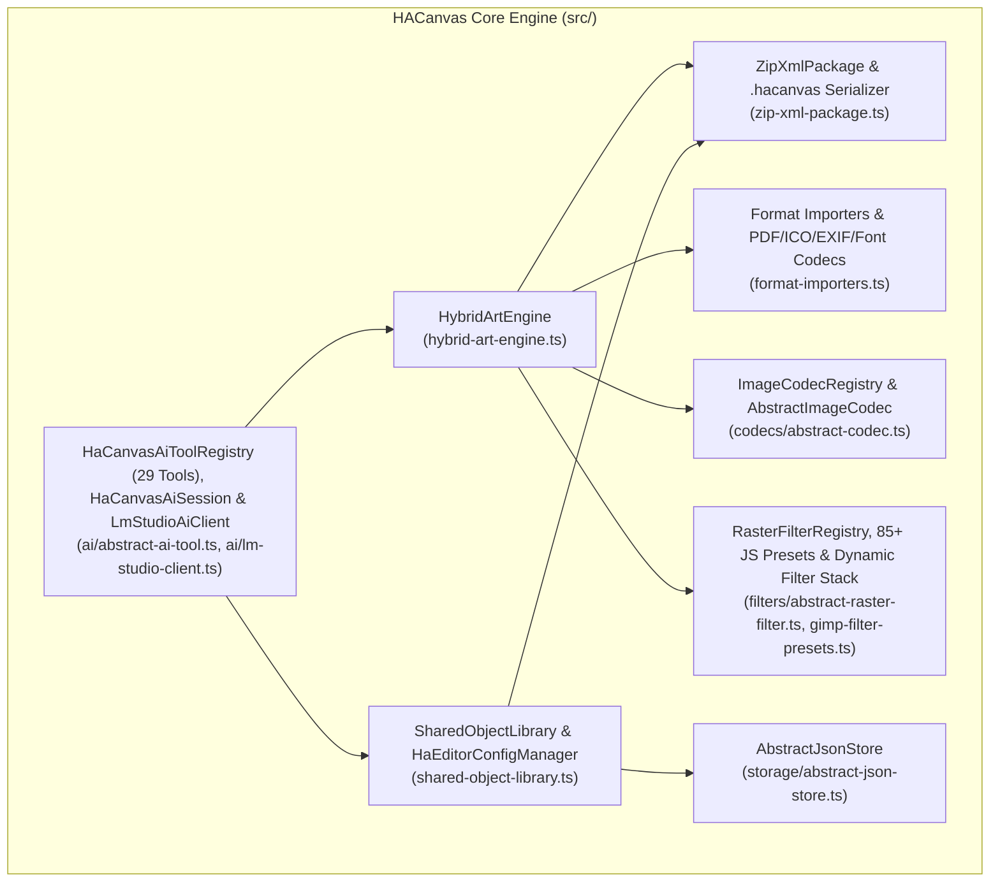

# HACanvas (`.hacanvas`)

**HACanvas** (`@nexustools/hacanvas`) is a TypeScript/Node.js hybrid 2D **Raster (GIMP) + Vector (Inkscape/SVG)** art engine, non-destructive dynamic filter & object caching pipeline, multi-format codec registry, cross-project Reusable Shared Object Library (`.haso`), and Open Packaging Conventions (`.docx`-style **ZIP + XML**) document package format (`.hacanvas`).

---

## Key Features

- **📦 `.hacanvas` Open Packaging ZIP + XML Document Format**:
  - Self-contained, lossless ZIP archive modeled after ECMA-376 Open Packaging Conventions (`[Content_Types].xml`, `_rels/.rels`, `canvas/document.xml`, `objects/<objectId>.xml`, `fonts/*`, `media/layer_*.raw`, `media/cel_*.raw`).
  - Stores vector layers, raw RGBA pixel buffers, attached non-destructive filter stacks (`<AttachedFilters>`), per-frame animation cels, cubic-Bezier keyframe interpolation tracks, custom JS filter & transition presets, document EXIF/GPS/XMP metadata, embedded fonts (`.ttf`, `.otf`, `.woff`, `.woff2`), and reusable Shared Object sub-canvases in a single portable package.
- **🖌️ GIMP-Grade Raster Compositing, Immediate & Non-Destructive Dynamic Filters**:
  - Full RGBA pixel layer management, blend modes (`normal`, `multiply`, `screen`, `overlay`, `add`, `darken`, `lighten`, `difference`), alpha opacity, and marching-ants selection masks (`rect`, `ellipse`, `invert`, `all`, `feather`, `grow`, `shrink`, `border`, `from_alpha`, `by_color`).
  - Sub-pixel anti-aliased strokes (`brush`, `pencil`, `airbrush`, `eraser`), contiguous flood-bucket fill (`tolerance`), linear/radial gradients, and pattern fills (`solid`, `checker`, `stripes`).
  - **85+ Built-in & Custom JavaScript GIMP Filters (`RasterFilterRegistry`)**:
    - **Immediate Mode (`rasterFilter`)**: Mutates raster layer pixels in-place immediately.
    - **Dynamic Non-Destructive Attachment (`attachFilter`, `updateAttachedFilter`, `removeAttachedFilter`, `bakeLayerFilters`, `setTargetFiltersEnabled`)**: Attach filter stacks to raster layers, vector layers, individual vector objects, or Shared Objects without touching underlying pixels or geometry.
    - **Cached Object Filter Pipeline (`objectRenderCache`)**: Objects with attached filters render their base geometry into an isolated cached RGBA canvas (`baseRgba`) and evaluate their filter stack into a cached `filteredRgba` buffer before compositing onto the parent canvas.
    - **Edit-Time Filter Bypass (`setObjectEditing`, `setSharedObjectEditing`)**: While an object or Shared Object is actively being edited, its attached filters automatically pause in the viewport for lag-free manipulation, then resume on edit completion.
    - **Export-Time Filter Guarantee & Format Conversion**: Exporting (`exportCanvas`) always renders all enabled attached filters (`forExport: true`),even if viewport preview (`previewDynamicFilters`) is toggled off. Formats that do not natively support GIMP pixel filters or raster layers (such as `.svg` and `.pdf`) automatically rasterize only filtered objects/layers into embedded PNG `<image>` elements while keeping unfiltered vectors crisp.
- **✒️ Inkscape-Grade Vector DOM, Shape Deformation & Geometry Engine**:
  - Parametric shapes (`rect`, `circle`, `ellipse`, `polygon`, `star`, `line`), cubic/quadratic Bezier paths (`path`), multi-line typography (`text`), and `<ObjectRef>` instances (`ref`).
  - **Interactive & Programmatic Vector Deformation (`deformVectorObject`, `inspectVectorObjectNodes`)**: Any existing vector object (`line`, `path`, `polygon`, `star`, `rect`, `circle`, `ellipse`) can be deformed by bending any segment into a quadratic Bezier curve while keeping endpoints fixed (`bend_segment`), moving individual vertices/endpoints (`move_endpoint`), straightening curved segments (`straighten_segment`), inserting or deleting vertices (`add_vertex`, `remove_vertex`), or converting primitive shapes to explicit node paths (`convert_to_path`).
  - Constructive Solid Geometry (CSG) Boolean path operations (`union`, `difference`, `intersection`, `exclusion`), path simplification (`simplify`), and dynamic path outset/inset (`offset`).
- **🧩 Reusable Categorized Shared Objects (`<ObjectRef>`) & Cross-Project Library (`.haso`)**:
  - Shared Objects are independent sub-canvases with their own vector and raster layers (`objects/<objectId>.xml`), attached filter stacks, and independent animation timelines, organized into slash-delimited folder hierarchies (e.g. `UI/Badges/GoldStar`, `Sprites/Items/RubyGem`).
  - Any vector layer on the main canvas (or inside another Shared Object, with automatic cycle detection) can instantiate `<ObjectRef>` references with per-instance `x`, `y`, `scaleX`, `scaleY`, `rotation`, `skewX`, `skewY`, `opacity`, `fillOverride`, `strokeOverride`, and per-instance `attachedFilters`.
  - `SharedObjectLibrary` persists `.haso` packages and `config.json` in the OS configuration directory so assets can be shared across projects.
- **🎞️ Hybrid Keyframe, Cubic-Bezier Curve & Raster Transition Animation Timeline**:
  - Tweened property keyframes (`x`, `y`, `x2`, `y2`, `cx`, `cy`, `width`, `height`, `r`, `rx`, `ry`, `scaleX`, `scaleY`, `rotation`, `skewX`, `skewY`, `opacity`, `fill`, `stroke`, `d`, `points`) with `linear`, `ease_in`, `ease_out`, `ease_in_out`, `ease_in_back`, `overshoot`, `snap`, `step`, and custom cubic-Bezier (`[x1, y1, x2, y2]`) easing curves.
  - Frame-by-frame raster cels and **27+ JavaScript Raster Transition Blend Presets** (`crossfade`, `luma_wipe`, `directional_wipe`, `pixel_dissolve`, `chromatic_morph`, `iris_circle`, `clock_radial`, `page_curl`, `ripple_wave`, `swirl_vortex`, etc.) supporting both same-layer and cross-layer keyframe blending.
  - Full timeline inspection (`inspectAnimationTimeline`) returning every track, keyframe segment, resolved `[x1, y1, x2, y2]` curve control points, and raster transition metadata.
- **🗂️ 18+ Multi-Format Importers & Exporters (`ImageCodecRegistry`)**:
  - Native codecs inheriting from `AbstractImageCodec` for `.hacanvas`, `.psd` (Photoshop), `.xcf` (GIMP), `.ai` (Adobe Illustrator PostScript & PDF/FlateDecode), `.pdf` (Multi-layer/page PDF with embedded fonts), `.svg` (Inkscape SVG), `.ora` (OpenRaster), `.png`, `.jpg`/`.jpeg`, `.webp`, `.tiff`, `.gif` (Animated & Static), `.bmp`, `.tga`, `.pcx`, `.ico` (Multi-layer per-entry BPP/PNG compression), `.cur` (Windows Cursor with hotspot), `.ppm`, `.ff` (Farbfeld), and `sprite_sheet`.
- **🤖 Built-In AI Tooling & Multi-Provider Streaming Client (`src/ai/`)**:
  - Ships with all **29 OpenAI/LM Studio function-calling AI tools** (`HaCanvasAiToolRegistry` / `AbstractAiTool`), a zero-boilerplate `HaCanvasAiSession` state adapter, tolerant streaming partial-JSON parser (`parsePartialJson`), and `LmStudioAiClient` (supporting OpenAI, Anthropic Claude, Google Gemini API Key & OAuth, xAI Grok, and LM Studio with configurable reasoning levels: `none`, `low`, `medium`, `max`).

---

## Architecture Overview



---

## Documentation Index

- [**Architecture & Scene Graph Guide (`docs/ARCHITECTURE.md`)**](docs/ARCHITECTURE.md)
- [**`.hacanvas` & `.haso` ZIP+XML File Format Specification (`docs/FILE_FORMAT_SPEC.md`)**](docs/FILE_FORMAT_SPEC.md)
- [**Complete API & AI Tooling Reference (`docs/API_REFERENCE.md`)**](docs/API_REFERENCE.md)

---

## Quick Start

```typescript
import {
    HybridArtEngine,
    HaCanvasAiSession,
    HaCanvasAiToolRegistry
} from "@nexustools/hacanvas";

// 1. Initialize the engine
const engine = new HybridArtEngine(process.cwd());

// 2. Create a 640x420 hybrid canvas with a Raster layer and a Vector layer
engine.createCanvas("main_doc", 640, 420, "#161822", [
    { name: "Backdrop Raster", type: "raster", visible: true, opacity: 1.0, blendMode: "normal" },
    { name: "Artwork Vector", type: "vector", visible: true, opacity: 1.0, blendMode: "normal" }
]);

// 3. Draw a vector rectangle and deform its top edge into a smooth curve
const rect = engine.drawShape("main_doc", "layer_2", {
    kind: "rect",
    x: 180,
    y: 120,
    width: 200,
    height: 140,
    fill: "#00d4ff",
    stroke: "#ffffff",
    strokeWidth: 3
});
engine.deformVectorObject("main_doc", rect.id, {
    mode: "bend_segment",
    segmentIndex: 0,
    targetX: 280,
    targetY: 75
});

// 4. Attach a non-destructive dynamic Drop Shadow filter directly to the vector object
engine.attachFilter("main_doc", {
    targetType: "object",
    targetId: rect.id,
    filterType: "drop_shadow",
    params: { offsetX: 8, offsetY: 8, radius: 6, opacity: 0.75 }
});

// 5. Inspect the scene graph (including active filters & resolved settings) and timeline
const scene = engine.inspectScene("main_doc");
const timeline = engine.inspectAnimationTimeline("main_doc");

// 6. Save as a portable .hacanvas Open Packaging ZIP+XML archive
engine.saveCanvas("main_doc", "artwork.hacanvas");
```

---

## Adding Full AI Support to Any Project Using `hacanvas`

Because all **29 AI tools**, `HaCanvasAiSession`, `parsePartialJson`, and `LmStudioAiClient` live directly inside `@nexustools/hacanvas`, any application (such as `AICore`, `HAEditor`, or custom web/desktop apps) can add full AI canvas creation, inspection, vector drawing, shape/line deformation, raster painting, immediate & dynamic GIMP filtering, Shared Object authoring, metadata/font management, and animation in just a few lines:

```typescript
import {
    HaCanvasAiSession,
    HaCanvasAiToolRegistry,
    LmStudioAiClient
} from "@nexustools/hacanvas";

// 1. Create an AI session backed by HybridArtEngine
const aiSession = new HaCanvasAiSession(process.cwd(), {
    canvasId: "main_doc",
    autoCreateCanvas: true
});

// 2. Execute any of the 29 built-in AI tools directly (or pass HaCanvasAiToolRegistry.getOpenAiToolsSchema() to any LLM)
await aiSession.executeTool("draw_vector_shape", {
    kind: "star",
    x: 240,
    y: 140,
    r: 70,
    sides: 5,
    innerRadius: 28,
    fill: "#ffcc00"
});

// 3. Attach a dynamic non-destructive filter via AI tool
await aiSession.executeTool("apply_gimp_filter", {
    mode: "attach",
    targetType: "layer",
    filterType: "bloom",
    params: { radius: 8, amount: 0.6 }
});

// 4. Inspect layer details (returns attachedFilters with full resolved settings & parameterSchemas)
const layerInfo = await aiSession.executeTool("inspect_layer", {});
```

---

## Building from Source

```bash
npm install
npm run build
```
