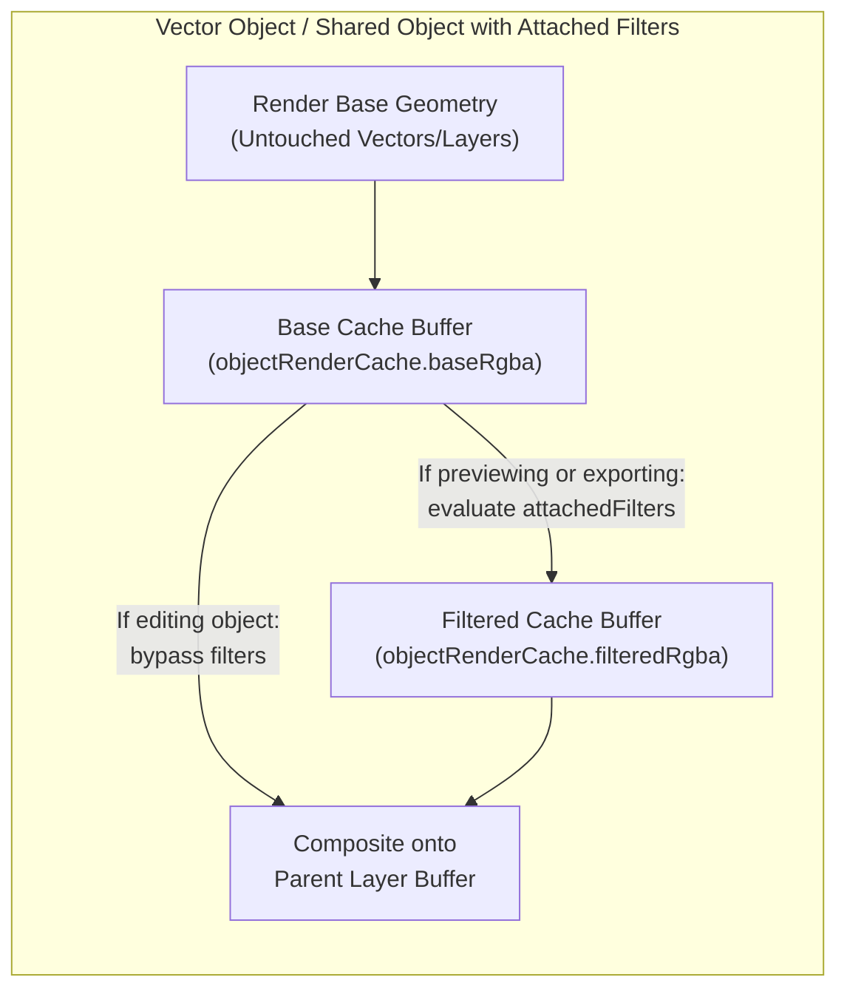

# HACanvas Architecture & Scene Graph Guide

## 1. Design Philosophy

`HACanvas` unifies two traditionally separate 2D graphics paradigms—**pixel-based raster painting/filtering (GIMP)** and **retained-mode SVG vector geometry (Inkscape)**—within a single deterministic scene graph, non-destructive dynamic filter pipeline, and Open Packaging ZIP+XML archive format (`.hacanvas`).

All subsystems are structured around clean abstract base class hierarchies:

| Base Class | Module | Responsibility |
| :--- | :--- | :--- |
| `AbstractImageCodec` | `src/codecs/abstract-codec.ts` | Magic-byte detection, multi-layer decoding, and binary encoding for `.hacanvas`, `.psd`, `.xcf`, `.ai`, `.pdf`, `.svg`, `.ora`, `.png`, `.jpg`, `.webp`, `.tiff`, `.gif`, `.bmp`, `.tga`, `.pcx`, `.ico`, `.cur`, `.ppm`, and `.ff`. |
| `AbstractRasterFilter` | `src/filters/abstract-raster-filter.ts` | Selection-aware RGBA pixel buffer convolution, neighborhood sampling, point-transfer, and 85+ programmable JavaScript GIMP/GEGL filters (`JsPresetRasterFilter`). |
| `AbstractJsonStore<T>` | `src/storage/abstract-json-store.ts` | Atomic JSON configuration and catalog persistence in OS-standard user configuration directories (`HaEditorConfigManager`, `SharedObjectLibrary`). |
| `AbstractAiTool` | `src/ai/abstract-ai-tool-base.ts` | Self-describing OpenAI/LM Studio function-calling tools (`HaCanvasAiToolRegistry`) with live partial-JSON streaming status labels and full execution against any `HaCanvasAiContext`. |

### 1.1 Modular Directory Layout (`src/`)
Every tool, filter, transition, importer, exporter, and codec resides in its own dedicated `.ts` module:
- `src/ai/tools/*.ts` — 33 individual `*AiTool` classes (1 class per file), registered in `src/ai/ha-canvas-ai-tool-registry.ts` with session state in `src/ai/ha-canvas-ai-session.ts` and streaming clients in `src/ai/abstract-ai-stream-client.ts` & `src/ai/lm-studio-ai-client.ts`.
- `src/filters/*.ts` & `src/filters/presets/*.ts` — `AbstractRasterFilter` (`abstract-raster-filter-base.ts`), concrete filter classes (`gaussian-blur-filter.ts`, `sharpen-filter.ts`, `invert-filter.ts`, `threshold-filter.ts`, `brightness-contrast-filter.ts`, `drop-shadow-filter.ts`, `js-preset-raster-filter.ts`, `raster-filter-registry.ts`), runtime helpers (`src/filters/runtime/`), and 121 individual GIMP filter preset files (`src/filters/presets/<filter-id>-filter-preset.ts`).
- `src/transitions/*.ts` — 14 individual raster keyframe blend transition files (`crossfade-transition.ts`, `step-hold-transition.ts`, `pixel-dissolve-transition.ts`, `directional-wipe-transition.ts`, `luma-wipe-transition.ts`, `venetian-blinds-wipe-transition.ts`, `clock-sweep-transition.ts`, `radial-iris-transition.ts`, `checkerboard-reveal-transition.ts`, `additive-glow-transition.ts`, `chromatic-morph-transition.ts`, `burn-exposure-transition.ts`, `ripple-warp-transition.ts`, `zoom-cross-blur-transition.ts`).
- `src/importers/*.ts` — Dedicated per-format importers (`png-importer.ts`, `bmp-importer.ts`, `tga-importer.ts`, `pcx-importer.ts`, `ppm-importer.ts`, `farbfeld-importer.ts`, `ico-importer.ts`, `xbm-importer.ts`, `ora-importer.ts`, `gif-importer.ts`, `psd-importer.ts`, `xcf-importer.ts`, `ai-importer.ts`, `pdf-importer.ts`, `svg-importer.ts`, `exif-xmp-metadata-importer.ts`, `any-image-importer.ts`).
- `src/exporters/*.ts` — Dedicated per-format exporters (`png-exporter.ts`, `bmp-exporter.ts`, `tga-exporter.ts`, `ppm-exporter.ts`, `farbfeld-exporter.ts`, `ico-exporter.ts`, `ora-exporter.ts`, `gif-exporter.ts`, `pdf-exporter.ts`, `svg-exporter.ts`, `spritesheet-exporter.ts`, `exif-xmp-metadata-exporter.ts`).
- `src/codecs/*.ts` — 14 individual `AbstractImageCodec` subclasses (`png-codec.ts`, `bmp-codec.ts`, `tga-codec.ts`, `pcx-codec.ts`, `ico-codec.ts`, `pnm-codec.ts`, `farbfeld-codec.ts`, `xbm-codec.ts`, `gif-codec.ts`, `ora-codec.ts`, `psd-codec.ts`, `xcf-codec.ts`, `ai-codec.ts`, `pdf-codec.ts`) + `image-codec-registry.ts`.
- `src/config/ha-editor-config-manager.ts` & `src/library/shared-object-library-manager.ts` — Persistent OS configuration and Shared Object Library managers.
- `src/types/` & `src/utils/` — Scene graph/metadata TypeScript interfaces and color, easing, category, and bitmap font utilities.


---

## 2. Scene Graph Data Model (`ArtCanvasState`)

Every open canvas in `HybridArtEngine` is represented by an `ArtCanvasState` object:

```typescript
export interface ArtCanvasState {
    canvasId: string;
    width: number;
    height: number;
    dpi: number;
    backgroundColor: string;
    selection: SelectionMaskSpec;
    layers: ArtLayerSpec[];
    sharedObjects: Record<string, SharedObjectCanvasSpec>;
    embeddedFonts?: Record<string, EmbeddedFontSpec>;
    metadata?: DocumentMetadataSpec;
    customFilterPresets?: GimpFilterPreset[];
    /** Global toggle for previewing attached dynamic filters in the viewport (default: true). Exporting always renders filters. */
    previewDynamicFilters?: boolean;
    animation: AnimationTimelineSpec;
    timeline: {
        fps: number;
        totalFrames: number;
        keyframes: Array<{ frame: number; targetId: string }>;
    };
}
```

### 2.1 Unified Layer Stack (`ArtLayerSpec`)
A canvas (or Shared Object sub-canvas) contains an ordered array of `ArtLayerSpec` layers rendered bottom-to-top (`index 0` is the bottommost layer; `layers[layers.length - 1]` is the topmost layer):
- **Raster Layers (`type: "raster"`)**:
  - Backed by uncompressed 32-bit RGBA pixel buffers (`width * height * 4` bytes) for frame `0` plus optional per-frame cel buffers (`celFrames`).
  - Supports both **immediate pixel filters** (`rasterFilter`, mutating the `.raw` buffer directly) and **non-destructive attached filter stacks** (`attachedFilters: AttachedFilterSpec[]`, `filtersEnabled?: boolean`).
- **Vector Layers (`type: "vector"`)**:
  - Backed by an ordered array of retained `VectorObjectSpec` nodes (`rect`, `circle`, `ellipse`, `polygon`, `star`, `line`, `path`, `text`, `boolean`, `image`, and `ref` for `<ObjectRef>` instances).
  - Supports layer-level `attachedFilters` as well as per-object `attachedFilters` on individual `VectorObjectSpec` items.

### 2.2 Vector Shape & Line Deformation (`deformVectorObject` & `inspectVectorObjectNodes`)
Every vector shape in `HACanvas` can be inspected and deformed at the vertex and segment level:
- **Line Deformation**: Lines (`kind: "line"`) support optional quadratic Bezier control points (`cx`, `cy`) to curve between `(x, y)` and `(x2, y2)`.
- **Path & Shape Deformation**: Multi-segment paths (`path`) and polygons/stars (`polygon`, `star`) store per-segment quadratic control points in `d` (`M ... Q cx cy x y ... L x y ...`). Parametric shapes (`rect`, `circle`, `ellipse`) are automatically tessellated into editable vertex/segment rings when deformed via `deformVectorObject` (`bend_segment`, `move_endpoint`, `straighten_segment`, `add_vertex`, `remove_vertex`, `convert_to_path`).

### 2.3 Categorized Shared Object Sub-Canvases (`SharedObjectCanvasSpec`)
Each Shared Object is an independent mini-canvas stored in `state.sharedObjects[objectId]`:
- Has its own `width`, `height`, `layers: ArtLayerSpec[]`, `attachedFilters?: AttachedFilterSpec[]`, `filtersEnabled?: boolean`, and `animation?: AnimationTimelineSpec`.
- Organized into hierarchical folder trees via `parseSharedObjectCategory(name, category)` and `buildCategoryTree(items)` (e.g. `"UI/Badges/GoldStar"` -> category `"UI/Badges"`, display name `"GoldStar"`).
- Referenced any number of times by `<ObjectRef>` (`kind: "ref"`, `refId: objectId`) on the main canvas or nested inside other Shared Objects with cycle detection.

---

## 3. Non-Destructive Dynamic Filter & Cached Object Rendering Pipeline



1. **Immediate vs. Dynamic Filters**:
   - Calling `engine.rasterFilter(...)` (or `apply_gimp_filter` with `mode: "immediate"`) mutates the target raster layer's pixel buffer immediately and permanently.
   - Calling `engine.attachFilter(...)` (or `apply_gimp_filter` with `mode: "attach"`) appends an `AttachedFilterSpec` to a layer (`ArtLayerSpec`), vector object (`VectorObjectSpec`), or Shared Object (`SharedObjectCanvasSpec`) without modifying underlying pixels or vector geometry.
2. **Cached Object Canvas (`objectRenderCache`)**:
   - When a `VectorObjectSpec` or `SharedObjectCanvasSpec` has attached filters, `HybridArtEngine` renders the un-filtered object into an offscreen cached RGBA buffer (`baseRgba`, keyed by geometry signature) and runs the enabled `attachedFilters` stack into `filteredRgba` (keyed by geometry + filter parameter signature).
   - Subsequent viewport renders reuse `filteredRgba` in $O(1)$ without re-evaluating expensive convolution filters unless the object or its filter parameters change.
3. **Edit-Time Filter Bypass (`setObjectEditing`, `setSharedObjectEditing`)**:
   - When an object or Shared Object is actively being edited (`editingObjectIds` / `editingSharedObjectIds`), `shouldRenderAttachedFilters` returns `false` during interactive viewport rendering (`forExport: false`) so the user/AI sees the crisp un-filtered geometry while editing. As soon as editing ends, dynamic filters automatically resume rendering.
4. **Export-Time Filter Rendering & Selective Rasterization**:
   - All export paths (`exportCanvas`) pass `{ forExport: true }`, which forces all enabled attached filters (`af.enabled !== false`) to render even if viewport preview (`previewDynamicFilters` or `filtersEnabled`) is toggled off.
   - For vector export formats (`svg`, `pdf`), `HybridArtEngine` checks `layerNeedsExportRasterization` and `objectNeedsExportRasterization`: unfiltered vector shapes/text are emitted as native `<path>`, `<rect>`, `<circle>`, and `<text>` primitives, whereas objects or layers with active pixel filters (or raster layers) are selectively rasterized into high-resolution PNG `<image>` elements.

---

## 4. Compositing & Animation Pipeline (`compositeCanvasFrame`)

When rendering any frame `f` of a canvas (or an isolated Shared Object sub-canvas):
1. **Background Fill**: Initializes an RGBA buffer of size `width × height × 4` filled with `backgroundColor`.
2. **Keyframe & Cubic-Bezier Curve Evaluation**:
   - Evaluates animated properties (`x`, `y`, `x2`, `y2`, `cx`, `cy`, `width`, `height`, `r`, `rx`, `ry`, `scaleX`, `scaleY`, `rotation`, `skewX`, `skewY`, `opacity`, `fill`, `stroke`, `d`, `points`) at frame `f` across all `AnimationTrackSpec` tracks using `evaluateCubicBezierEasing(t, controlPoints)` or preset easing modes.
   - Enforces per-layer and per-object timeline visibility spans (`startFrame <= f <= endFrame`).
3. **Raster Cel & Cross-Layer Transition Blending**:
   - Evaluates `rasterCel` keyframe tracks using the configured `RasterBlendPreset` JavaScript transition (`crossfade`, `luma_wipe`, `directional_wipe`, `pixel_dissolve`, `chromatic_morph`, or custom JS) between consecutive cels or across a target raster layer (`rasterBlendTargetLayerId`).
4. **Layer-by-Layer Compositing & Dynamic Filter Stack**:
   - Renders each visible layer (`renderLayerToBuffer`), applying object-level and layer-level `attachedFilters` when active, and blends into the composite buffer using the layer's `blendMode` and `opacity`.

---

## 5. Non-Destructive Multi-Step Undo / Redo Engine

`HybridArtEngine` maintains per-canvas undo and redo stacks (`undoStacks` and `redoStacks`) storing full scene + raster buffer snapshots (`CanvasHistoryEntry`):
- Every mutating operation records a descriptive action label (e.g., `"Draw Shape (star)"`, `"Deform Vector Object (bend_segment)"`, `"Attach Filter (Gaussian Blur -> Layer 'Hero')"`, `"Bake 2 Filter(s) on Layer"`).
- Interactive drag operations use `beginUndoGroup(canvasId, label)` / `endUndoGroup(canvasId, label)` or `withUndoGroup(canvasId, label, fn)` so a continuous pointer drag records a single atomic undo step.
